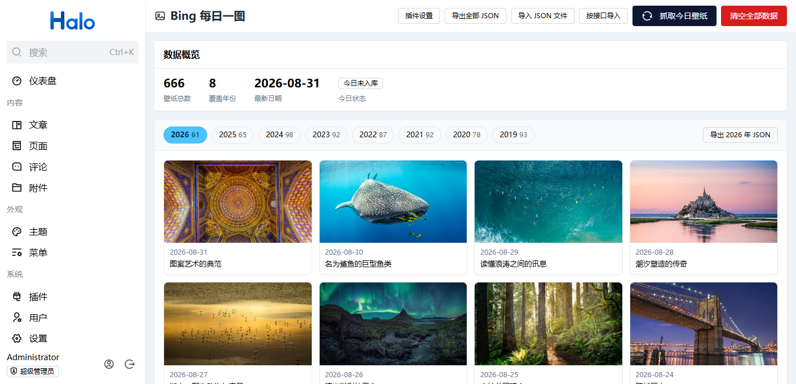

# Bing 每日一图

预览 Bing 每日一图（CN）的全部壁纸参数，支持历史数据导入、每日定时抓取与 JSON 导出。本插件由 AI 辅助开发。

[](https://www.halo.run)
[](LICENSE)


在线预览：[Bing 每日一图](https://i.dearend.wang/bing-wallpaper)




## 功能特性

**前台**

- 独立页面 `/bing-wallpaper`（路径可配置），自动套用当前主题页头页脚
- 「今日一图」聚光卡 + 年份筛选 + 分页 + 瀑布流卡片，明暗双配色
- 全参数展示：标题 / 副标题 / 版权 / 故事详情 / 日期
- 必应官方多分辨率原图下载

**后台**

- 概览统计、抓取今日壁纸、按接口导入 / 上传 JSON 文件导入、单年 / 合并导出
- 年份浏览、原生分页、详情弹窗（复制 JSON / 删除）、清空全部数据（二次确认）
- 每日定时抓取：自定义时间（北京时间），失败自动重试，当天幂等不重复
- 角色权限：「壁纸查看」仅浏览与导出；「壁纸管理」才能抓取、导入、删除、清空

**集成**

- 主题覆盖模板：提供 `templates/bing-wallpaper.html` 即可接管渲染
- Finder API：主题模板服务端直接取今日壁纸、年份列表、分页数据
- 匿名只读 REST API：浏览器 JS 可直接调用

## 安装

### 系统要求

- Halo >= 2.26.0

### 手动安装

1. 前往 [Releases](https://github.com/DEARENDWANG/plugin-bing-wallpaper/releases) 下载 `plugin-bing-wallpaper-1.0.1.jar`
2. Halo 后台 → 插件 → 安装插件 → 上传 JAR
3. 启用插件

### 升级

后台「插件」页面上传新版本 JAR 覆盖安装即可；配置与壁纸数据保留。

## 快速开始

1. **导入历史数据**（二选一）：
   - 管理页「导入 JSON 文件」：上传 `year_YYYY.json` 或合并文件；
   - 设置「数据源」填写含 `{year}` 占位符的接口模板，点「按接口导入」。历史数据仓库参考：[DEARENDWANG/bing-wallpaper](https://github.com/DEARENDWANG/bing-wallpaper)，其 Pages 地址形如 `https://dearendwang.github.io/bing-wallpaper/CN/year_{year}.json`。
2. **每日抓取**：设置「每日抓取」开关与时间；到点自动抓取当天壁纸入库，已有则跳过。
3. 访问 `http(s)://你的站点/bing-wallpaper` 浏览全部年份壁纸。

## 配置项

### 数据源

| 字段 | 说明 | 默认 |
| --- | --- | --- |
| 历史数据接口模板 | 含 `{year}` 占位符，仅导入时使用；含内网地址防护 | 空（自行填写） |
| 起始年份 | 按接口导入的起点 | 2019 |

### 每日抓取

| 字段 | 说明 | 默认 |
| --- | --- | --- |
| 启用自动抓取 | 到点直连 cn.bing.com 官方接口 | 开 |
| 抓取时间 | 北京时间 HH:mm，失败每 10 分钟重试 | 00:02 |

### 前台页面

| 字段 | 说明 | 默认 |
| --- | --- | --- |
| 页面标题 | 前台主标题与浏览器标题 | Bing 每日一图 |
| 路由路径 | 支持多级路径，保存即生效 | bing-wallpaper |
| 每页数量 | 1–100 | 24 |

## 主题适配

### 方式一：覆盖模板

在当前主题提供 `templates/bing-wallpaper.html` 即可接管渲染（建议复用 `layout :: html(...)` 保持主题外壳）。可用模型变量：

| 变量 | 说明 |
| --- | --- |
| `wallpapers` | 当前页壁纸列表（字段见下文数据格式） |
| `years` / `year` | 年份列表（year/count）/ 当前选中年份 |
| `page` / `totalPages` / `yearTotal` / `pageSize` | 分页信息 |
| `total` / `today` | 总条数 / 今日壁纸（无则为 null） |
| `routePath` / `pageTitle` | 配置的路由路径 / 页面标题 |
| `_templateId` | `plugin:plugin-bing-wallpaper:bing-wallpaper` |

### 方式二：Finder（服务端 Thymeleaf）

```html
<div th:with="w=${bingWallpaperFinder.today()}">
  
  <p th:text="${w.subtitle}"></p>
</div>
```

| 方法 | 返回 |
| --- | --- |
| `today()` / `get(date)` | `Mono<WallpaperVo>` |
| `listByYear(year)` | `Flux<WallpaperVo>`（日期降序） |
| `listByYear(year, page)` / `listByYear(year, page, size)` | `Mono<ListResult<WallpaperVo>>` |
| `years()` | `Flux<YearCount>`（year / count） |
| `routePath()` / `pageSize()` / `pageTitle()` | 读取插件设置 |

`WallpaperVo` 字段：`date year title caption subtitle copyright description bingUrl url urlbase formats`。

### 方式三：匿名只读 API

```
GET /apis/api.bingwallpaper.dearend.wang/v1alpha1/wallpapers?page=1&size=20&year=2026
GET /apis/api.bingwallpaper.dearend.wang/v1alpha1/wallpapers/today
GET /apis/api.bingwallpaper.dearend.wang/v1alpha1/wallpapers/years
```

## 数据格式

导出 / 导入兼容如下结构（导入时多余字段忽略；缺少官方链接信息时保留原值）：

```json
{
  "title": "冰下秘境",
  "caption": "冰下秘境",
  "subtitle": "亚伯拉罕湖，艾伯塔省，加拿大",
  "copyright": "© Guang Cao/Getty Images",
  "description": "黎明的第一缕曙光映照在……",
  "date": "2026-11-13",
  "bing_url": "https://cn.bing.com/th?id=OHR.AbrahamCanada_ZH-CN0344365912_UHD.jpg",
  "url": "https://cn.bing.com/th?id=OHR.AbrahamCanada_ZH-CN0344365912_1920x1080.jpg",
  "urlbase": "/th?id=OHR.AbrahamCanada_ZH-CN0344365912",
  "formats": {
    "UHD": "https://cn.bing.com/th?id=OHR.AbrahamCanada_ZH-CN0344365912_UHD.jpg",
    "1920x1080": "https://cn.bing.com/th?id=OHR.AbrahamCanada_ZH-CN0344365912_1920x1080.jpg"
  }
}
```

## 数据与隐私

- 不收集任何用户个人数据；无遥测、统计、崩溃上报或跨站追踪
- 仅存储公开壁纸元数据（标题/副标题/版权/故事/日期/官方图片链接）于站点数据库（Halo 扩展存储）
- 数据可随时导出备份；单条可删除；「清空全部数据」二次确认后执行，清空当天停止自动补抓、次日恢复
- 卸载后数据默认保留（Halo 生命周期约定，重装可恢复）

## 外部服务

| 服务 | 用途 | 数据流向 |
| --- | --- | --- |
| cn.bing.com（HPImageArchive.aspx） | 抓取当日壁纸元数据 | 仅出站请求，不发送站点数据 |
| 用户自配历史数据接口（可选） | 手动导入历史数据 | 服务端请求；含内网/保留地址防护与逐跳重定向校验 |

图片始终热链必应官方地址，本插件不存储、不再分发图片文件；图片版权归 Bing 及原作者所有，使用请遵循权利人条款。本插件与 Microsoft / Bing 无关联，名称中的 "Bing" 仅用于指明数据来源。

## 常见问题

- **数据存在哪？** Halo 数据库（自定义模型 `Wallpaper`），禁用 / 重载插件不丢数据；跨站迁移请用导出 / 导入。
- **抓取失败怎么办？** 每 10 分钟自动重试直到当天入库；也可在管理页手动「抓取今日壁纸」。
- **为什么没有第三方图床链接？** 仅收录 Bing 官方地址，避免镜像失效与版权风险。
- **支持其他区域吗？** 当前仅 CN，多区域不在路线图内。

## 从源码构建

```bash
./gradlew build          # 产物 build/libs/plugin-bing-wallpaper-*.jar
./gradlew haloServer     # Docker 启动真实 Halo 调试（需 Docker）
```

环境：JDK 21+；UI 工具链（Node 20 / pnpm 9）由 Gradle 自动管理。

## 更新日志

### v1.0.1

- 修正「壁纸查看 / 壁纸管理」角色权限规则：查看可用统计与导出，管理可用抓取 / 导入 / 删除 / 清空，与文档一致
- JSON 导入在读体过程中即执行 32MB 限制；公开 years 接口改为按年索引统计
- 抓取 / 导入 / 删除 / 清空后等待数据真正可见再刷新页面，概览与列表不再短暂不一致

### v1.0.0

- 初始版本：每日抓取、历史导入 / 导出、前台壁纸档案页、Console 管理页
- 主题适配三路径：模板覆盖 / Finder / 匿名只读 API